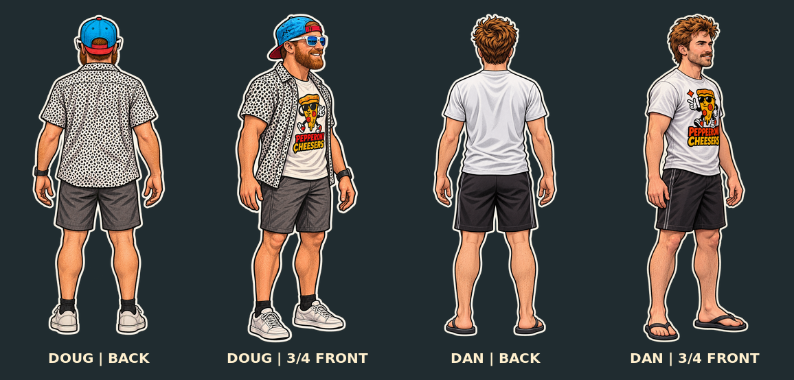

# Character Lab turnaround candidates

New full-body transparent RGBA review drawings for the isolated Character Lab.
No runtime imports, rig changes, or changes to the shipped game or original art.

| Character | Rear (180°) | Front three-quarter (roughly 45° toward screen right) |
| --- | --- | --- |
| Doug | [PNG](doug-back.png) | [PNG](doug-three-quarter.png) |
| Dan | [PNG](dan-back.png) | [PNG](dan-three-quarter.png) |

## Provenance and handoff

Generated using OpenAI ImageGen with the actual [Doug ready sprite](../../../public/assets/doug/ready.png)
or [Dan ready sprite](../../../public/assets/dan/ready.png) as the image reference.
Source revision: `f0d0398a27a139c34e493b5af8af309cb47f3cce`. The original files
are untouched. Rear garment details not visible in the source are interpretations.
The four PNGs retain the native ImageGen frame dimensions and are prepared for
transparent compositing; the labeled montage is for review only.

These are candidate **drawings**, not rig atlases. Confirm the angle, stance,
likeness, front shirt print and edge treatment in the Lab. Align each view to
the same standing scale and foot anchors before comparing an uncut turn.
Separate the limbs with hidden overlaps and record joint/palm anchors in the
Lab's actual asset format before driving these from the shared skeleton.
No back three-quarter, left-facing three-quarter, or movement validation is
claimed. Do not assume mirroring preserves asymmetric accessories.
